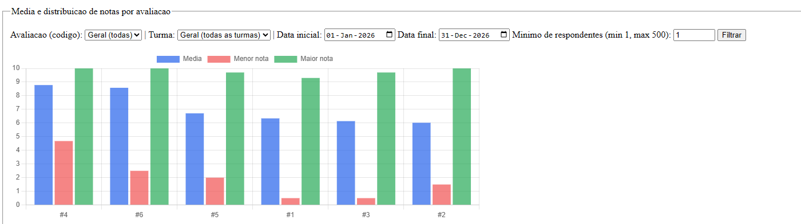
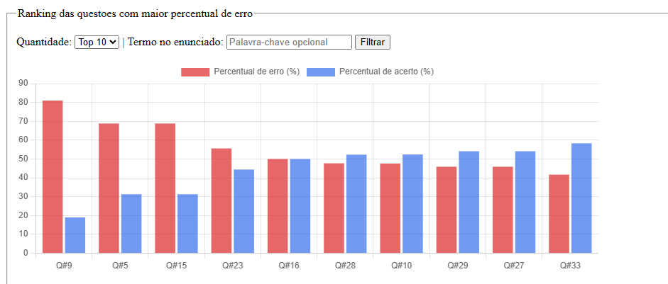
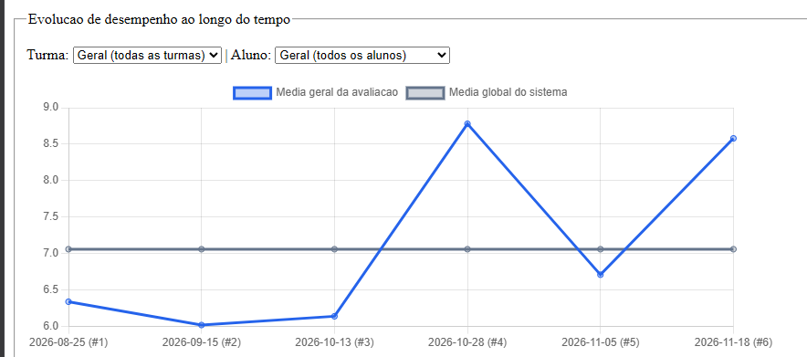
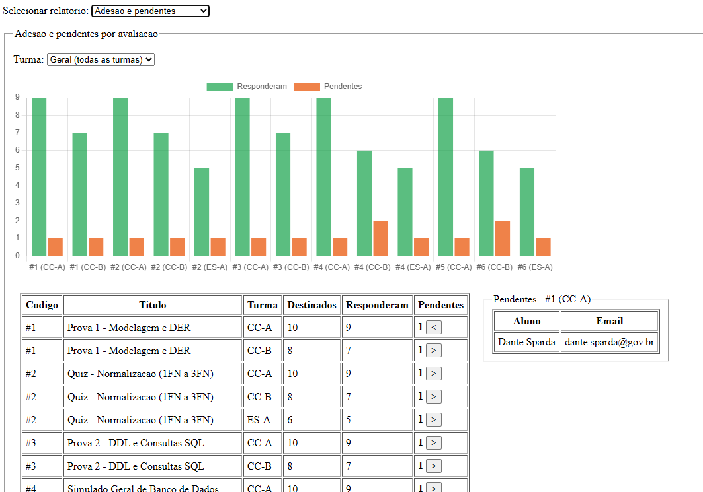

Projeto Banco de Dados I

Integrantes:
  Cassiano Sampaio Campana - 201900560042
  Eric Yuhki Sato - 202000560067

I.  Natureza e proposta escolhida para o projeto
  Avaliação de aprendizagem (provas, simulados, quizzes); Cada questão tem um valor na avaliação.
  O sistema registra a nota obtida em cada questão (automática nas objetivas, dada pelo professor nas de texto livre)
  e calcula a nota total de cada aluno.

II. Como Executar o Sistema
  1. Pré-requisitos instalados na máquina:
     - PostgreSQL (14 ou superior) em execução na porta 5432
     - Java JDK 21
     - Node.js (18 ou superior) e npm
     - Git

  2. Clonar o repositório e entrar na pasta do projeto:
     git clone <URL_DO_REPOSITORIO>
     cd <PASTA_DO_REPOSITORIO>

  3. Criar o banco de dados no PostgreSQL e carregar os scripts na ordem abaixo:
     psql -U postgres -c "CREATE DATABASE avaliacoes_db;"
     psql -U postgres -d avaliacoes_db -f database/schema.sql
     psql -U postgres -d avaliacoes_db -f database/carga.sql

  4. Configurar e iniciar o back-end:
     - Caso o usuário, a senha ou a porta do PostgreSQL na máquina sejam diferentes do padrão (postgres / 1234 / 5432), ajuste o arquivo backend/src/main/resources/application.properties.
     - Em um terminal na raiz do projeto, execute:

     No Windows (PowerShell ou CMD):
       cd backend
       .\mvnw.cmd spring-boot:run

     No Linux ou macOS:
       cd backend
       chmod +x mvnw
       ./mvnw spring-boot:run

     O servidor back-end ficará disponível em http://localhost:8080.

  5. Instalar dependências e iniciar o front-end:
     - Em outro terminal na raiz do projeto, execute (Windows, Linux ou macOS):
       cd frontend
       npm install
       npm run dev

  6. Acessar o sistema no navegador:
     - Abra http://localhost:5173
     - Logins de exemplo presentes na carga de teste:
       Professor: geralt.rivia@gov.br | Senha: 123456
       Aluno:     dante.sparda@gov.br | Senha: dragon

III. Descrição dos Relatórios

  Relatório 1 — Média, menor e maior nota por avaliação comparada com a média geral
    Objetivo:
      Apresentar em tabela e gráfico de barras a média, a menor nota e a maior nota de cada avaliação filtrada por código, turma, período de datas e quantidade mínima de respondentes, comparando com a média geral do sistema.
    Recursos SQL utilizados:
      Junção interna (INNER JOIN), agregação e agrupamento (COUNT, AVG, MIN, MAX, SUM, GROUP BY, HAVING), subconsulta (média geral do sistema e tabela derivada), filtros diversos (WHERE com BETWEEN de datas) e ordenação (ORDER BY).
    Imagem da tela:
      
    SQL utilizado:
```sql
SELECT
    av.codigo,
    av.titulo,
    COUNT(notas_aluno.id_aluno) AS qtd_respondentes,
    ROUND(AVG(notas_aluno.nota_total), 2) AS media_avaliacao,
    ROUND(MIN(notas_aluno.nota_total), 2) AS menor_nota,
    ROUND(MAX(notas_aluno.nota_total), 2) AS maior_nota,
    ROUND((
        SELECT AVG(sub.total)
        FROM (
            SELECT SUM(r2.nota) AS total
            FROM Resposta r2
            GROUP BY r2.ID_aluno, r2.codigo_avaliacao
        ) sub
    ), 2) AS media_geral_sistema
FROM Avaliacao av
INNER JOIN (
    SELECT
        s.ID_aluno AS id_aluno,
        s.codigo_avaliacao,
        s.data,
        mt.codigo_turma,
        SUM(r.nota) AS nota_total
    FROM Soluciona_avaliacao s
    INNER JOIN Aluno al ON al.ID=s.ID_aluno
    INNER JOIN Matricula_turma mt ON mt.matricula=al.matricula
    INNER JOIN Resposta r
        ON r.ID_aluno=s.ID_aluno
       AND r.codigo_avaliacao=s.codigo_avaliacao
    WHERE s.data BETWEEN '2026-01-01' AND '2026-12-31'
    GROUP BY s.ID_aluno, s.codigo_avaliacao, s.data, mt.codigo_turma
) notas_aluno ON notas_aluno.codigo_avaliacao=av.codigo
GROUP BY av.codigo, av.titulo
HAVING COUNT(notas_aluno.id_aluno)>=1
ORDER BY media_avaliacao DESC;
```

  Relatório 2 — Ranking das questões com maior percentual de erro
    Objetivo:
      Listar em gráfico de barras e tabela o ranking das questões com maior percentual de perda/erro e menor aproveitamento médio nas avaliações, permitindo filtrar por palavra-chave no enunciado.
    Recursos SQL utilizados:
      Junção interna (INNER JOIN), agregação e agrupamento (COUNT, AVG, GROUP BY), filtros diversos (WHERE com LIKE), e ordenação e ranking (RANK() OVER, ORDER BY e FETCH FIRST n ROWS ONLY).
    Imagem da tela:
      
    SQL utilizado:
```sql
SELECT
    q.codigo,
    q.enunciado,
    COUNT(r.ID_aluno) AS total_respostas,
    ROUND(AVG(COALESCE(r.nota/NULLIF(ia.valor, 0), 0)*100.0), 1) AS percentual_acerto,
    ROUND(100.0-AVG(COALESCE(r.nota/NULLIF(ia.valor, 0), 0)*100.0), 1) AS percentual_erro,
    RANK() OVER (ORDER BY AVG(COALESCE(r.nota/NULLIF(ia.valor, 0), 0)) ASC) AS ranking_dificuldade
FROM Questao q
INNER JOIN Item_avaliacao ia ON ia.codigo_questao=q.codigo
INNER JOIN Resposta r
    ON r.codigo_avaliacao=ia.codigo_avaliacao
   AND r.codigo_questao=ia.codigo_questao
WHERE LOWER(q.enunciado) LIKE LOWER('%%')
GROUP BY q.codigo, q.enunciado
ORDER BY ranking_dificuldade ASC, total_respostas DESC
FETCH FIRST 10 ROWS ONLY;
```

  Relatório 3 — Evolução de desempenho ao longo do tempo (geral, por turma ou por aluno)
    Objetivo:
      Acompanhar em gráfico de linha e tabela a evolução cronológica das notas (geral, média de uma turma escolhida ou nota individual de um aluno) comparada com a média de referência de cada avaliação.
    Recursos SQL utilizados:
      Junção interna (INNER JOIN), subconsulta correlacionada (cálculo da média de cada avaliação), agregação e agrupamento (SUM, AVG, GROUP BY), filtro (WHERE) e ordenação temporal (ORDER BY s.data ASC).
    Imagem da tela:
      
    SQL utilizado:
```sql
SELECT
    s.data,
    av.codigo,
    av.titulo,
    ROUND(SUM(r.nota), 2) AS nota_selecionada,
    ROUND((
        SELECT AVG(outros.total_colega)
        FROM (
            SELECT SUM(r2.nota) AS total_colega
            FROM Resposta r2
            WHERE r2.codigo_avaliacao=av.codigo
            GROUP BY r2.ID_aluno
        ) outros
    ), 2) AS media_referencia
FROM Soluciona_avaliacao s
INNER JOIN Avaliacao av ON av.codigo=s.codigo_avaliacao
INNER JOIN Resposta r
    ON r.ID_aluno=s.ID_aluno
   AND r.codigo_avaliacao=s.codigo_avaliacao
WHERE s.ID_aluno=2
GROUP BY s.data, av.codigo, av.titulo
ORDER BY s.data ASC;
```

  Relatório 4 — Adesão, alunos pendentes por avaliação/turma e questões nunca utilizadas
    Objetivo:
      Exibir em gráfico de barras e tabela o total de alunos destinados que já responderam e os que ainda estão pendentes em cada avaliação/turma (abrindo na lateral os nomes e e-mails dos pendentes), além das questões cadastradas nunca utilizadas em avaliações.
    Recursos SQL utilizados:
      Junção externa (LEFT JOIN), junção interna (INNER JOIN), filtros diversos (WHERE com IN e IS NULL), agregação e agrupamento (COUNT, GROUP BY) e ordenação (ORDER BY).
    Imagem da tela:
      
    SQL utilizado:
```sql
SELECT
    av.codigo,
    av.titulo,
    t.codigo AS codigo_turma,
    t.nome AS turma,
    COUNT(al.ID) AS total_destinados,
    COUNT(s.ID_aluno) AS responderam,
    COUNT(al.ID)-COUNT(s.ID_aluno) AS pendentes
FROM Avaliacao av
INNER JOIN Destinada d ON d.codigo_avaliacao=av.codigo
INNER JOIN Turma t ON t.codigo=d.codigo_turma
INNER JOIN Matricula_turma mt ON mt.codigo_turma=t.codigo
INNER JOIN Aluno al ON al.matricula=mt.matricula
LEFT JOIN Soluciona_avaliacao s
    ON s.ID_aluno=al.ID
   AND s.codigo_avaliacao=av.codigo
WHERE t.codigo IN (101, 102, 103)
GROUP BY av.codigo, av.titulo, t.codigo, t.nome
ORDER BY av.codigo, t.nome;

SELECT
    av.codigo AS codigo_avaliacao,
    av.titulo AS avaliacao,
    t.codigo AS codigo_turma,
    t.nome AS turma,
    al.ID AS id_aluno,
    al.nome AS aluno,
    al.email
FROM Avaliacao av
INNER JOIN Destinada d ON d.codigo_avaliacao=av.codigo
INNER JOIN Turma t ON t.codigo=d.codigo_turma
INNER JOIN Matricula_turma mt ON mt.codigo_turma=t.codigo
INNER JOIN Aluno al ON al.matricula=mt.matricula
LEFT JOIN Soluciona_avaliacao s
    ON s.ID_aluno=al.ID
   AND s.codigo_avaliacao=av.codigo
WHERE t.codigo IN (101, 102, 103)
  AND s.ID_aluno IS NULL
ORDER BY av.codigo, t.nome, al.nome;

SELECT
    q.codigo,
    CASE WHEN qo.codigo IS NOT NULL THEN 'OBJETIVA' ELSE 'DISSERTATIVA' END AS tipo,
    q.enunciado
FROM Questao q
LEFT JOIN Questao_objetiva qo ON qo.codigo=q.codigo
LEFT JOIN Item_avaliacao ia ON ia.codigo_questao=q.codigo
WHERE ia.codigo_avaliacao IS NULL
ORDER BY q.codigo;
```
